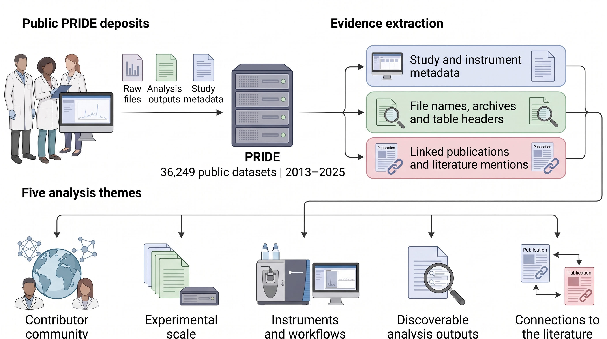

# The data economy of public proteomics: thirteen years of PRIDE

## Abstract

PRIDE's public archive records how proteomics research changes as its community grows. We examined all 36,249 datasets released between 2013 and 2025 using study records, deposited files and links to published papers. The contributor community broadened, and linked papers appeared in a wider range of journals. Large datasets became more numerous, although the median number of mass-spectrometry runs per dataset fell. New instruments and software appeared in deposits alongside older ones. We recognised peptide or protein identification results in 80% of 2025 datasets by reading files produced by individual analysis programs; 16% contained results in community-standard formats. We detected no association between those standard formats and dataset mentions in the other papers we analysed. Mentions alone cannot show that the data were analysed again. Searching the formats used by individual analysis programs could help readers find more of the results already shared through PRIDE.

## Graphical abstract

Created with BioRender.

## Introduction

Researchers prepare proteomics data and results for public release and publication. Later work can build on them. We use data economy to mean this circulation of data after an experiment. Costs and prices are outside our scope. PRIDE, the largest repository in the ProteomeXchange network of proteomics data repositories, preserves mass-spectrometry proteomics data from a growing community, makes them publicly accessible and links deposits to the published literature [PRIDE2025] [PX2026].

Evidence in PRIDE's deposited files connects the growth recorded in repository reports to changing experiments and analytical workflows. Raw files record experimental runs and instrument labels. We identify the analysis software from logs and parameter files. With dates and publication links, these records trace the history of a study and make changes in research practice visible across the archive.

An archive-wide view of PRIDE complements studies of public-data impact through citations [PerezRiverol2019] and examinations of selected deposits. These examinations include six reanalysed projects [Vadadokhau2026] and an audit of 500 datasets [Leite2026]. Deposited files also show how developments described elsewhere, including large cohorts [Geyer2017] [Messner2023] and standard result formats [PSI2023], appear in the public record.

We examine all 36,249 PRIDE datasets released between 2013 and 2025. We follow the expanding contributor community by comparing dataset sizes and recorded workflows, then examine result files to identify analytical content beyond standard result formats. Literature links extend this account to publication and later attention. The analysis describes deposits rather than instrument ownership or adoption dates. For each analysis, we report the number of records used as its denominator and, where computed, 95% intervals from resampling contributor groups. We approximate these groups by linking datasets through identifiers derived from principal-investigator contacts. Mentions of PRIDE dataset identifiers (accessions) in later papers provide an incomplete proxy for reuse and do not establish reanalysis.

## Results

### PRIDE reached a broader contributor community

PRIDE expanded across contributor groups and the journals publishing their work. Comparing 2023 to 2025 with 2013 to 2015, the effective number of groups increased 5.0-fold and that of journals 5.4-fold (95% interval 4.7 to 6.3) (Fig. 1a,b; Supplementary Tables S2 and S3). By publication year, the number of distinct journals publishing linked papers rose from 78 in 2013 to 627 in 2025 (Supplementary Table S18). Effective numbers account for both the number of categories and how evenly datasets are distributed among them (Box 1).

Broader participation accompanied more even representation of instrument models. Their effective number increased 1.8-fold (1.6 to 2.0), although the number of distinct models expected in equal-sized samples did not increase (62 against 66 per 1,500 datasets). The effective number of species decreased to 0.67 times its earlier value (0.56 to 0.80). For contributor groups, journals, instrument models and species, the direction of change agreed between orders 1 and 2, which give different weights to common categories (Supplementary Table S3).

At order 2, Supplementary Table S3 shows no detectable change in the effective numbers of analysis tools, research subfields, countries and instrument vendors. The effective numbers increased at different times: instrument models mainly from 2020, journals until 2022, and tools only in 2024 and 2025 (Fig. 1a).

Human and mouse accounted for most of the concentration in species. Human samples were named in 41% of datasets released in 2013 and 52% of those released in 2025; mouse was named in 11% and 19%. Datasets naming neither species made up 46% of deposits during 2013 to 2016, compared with 33% during 2023 to 2025 (Supplementary Fig. 9). Among the 354 groups contributing in both periods, this share also declined (from 40% to 32%), so changes in which groups contributed explained only part of the decline.

New contributors continued to supply a substantial share of PRIDE's deposits. Groups with no earlier PRIDE release since 2013 contributed between 42% and 48% of annual deposits during 2020 to 2025 (44% in 2025; Fig. 1c,d). Two-thirds of all groups deposited a single dataset, accounting for a quarter of all datasets (Tables S4 and S5; Supplementary Fig. 1).

The number of datasets from groups whose country could be identified increased 3.3-fold when comparing 2023 to 2025 with 2016 to 2018. Half of the additional datasets came from Europe (Fig. 1e to g; Supplementary Figs 10 and 11; Supplementary Table S6). Datasets from China increased 5.2-fold over these periods, compared with 2.8-fold for Germany. China's share of datasets whose country could be identified rose from 3% in 2013 to 15% in 2025. These counts concern PRIDE only and exclude groups that deposit only in other repositories, including iProX [Ma2019], jPOST [Okuda2017] or MassIVE [PX2026].

### Archive growth encompassed experiments at different scales

PRIDE's growth [PRIDE2025] accommodated experiments at different scales. The median number of raw runs (mass-spectrometry acquisitions) per dataset was 16 for 2023 to 2025 (n = 15,248), compared with 30 for 2013 to 2016 (n = 2,498), a ratio of 0.53 (95% interval 0.48 to 0.63). The whole distribution shifted towards fewer runs (Fig. 2a).

Large deposits nevertheless became more numerous. The mean annual number of datasets with at least 100 runs was 124 during 2013 to 2016 and 459 during 2023 to 2025, while their share of all datasets fell from 19.8% to 9.0% (Fig. 2b). Such deposits are relevant to the scale proposed for proteomics studies of participant cohorts [Geyer2017] [Messner2023]. Run counts differ from sample counts because isobaric labelling uses tags to measure several samples together in one run. The mean number of channels per labelled dataset increased from 6 in 2014 to 13 in 2025 as TMTpro [Li2020] replaced iTRAQ [Ross2004]; these labelling methods use channels to distinguish the samples (Supplementary Fig. 8).

The decrease in median runs persisted across five sensitivity analyses: combining datasets from the same paper; counting exact runs only; collapsing fraction-numbered runs; reweighting to the 2013 to 2016 composition of vendor, acquisition mode, labelling, species and submission type; and stratifying by country (Fig. 2c; Supplementary Table S8). Datasets labelled with tandem mass tags (TMT) [Thompson2003], and those naming SCIEX or Bruker instruments, showed no detectable decrease in median raw runs (early Bruker n = 56).

Among the 3,456 groups contributing in multiple years, the slope over time of the base-2 logarithm of raw-run counts, estimated within groups, was about 38% of the pooled slope on the same 23,486 datasets. For 2018 to 2025 releases, the matched ratio of geometric means of run counts in first-time versus returning groups was 0.64 (0.61 to 0.68). Geometric means average counts on a logarithmic scale; the comparison stratified datasets by release year, vendor, acquisition mode, human-sample status and continent.

Individual runs occupied more storage. Median raw-run size increased from 0.35 GB in 2013 to 1.07 GB in 2025. Median raw-run sizes were 0.44 GB on the LTQ Orbitrap [Makarov2006] and 3.95 GB on the Orbitrap Astral [Stewart2023] (Fig. 2d; Supplementary Table S7). Among datasets naming one instrument model and having exact run counts, we separated the change in mean log10 (base-10 logarithm) bytes per run between the 2014 to 2016 and 2023 to 2025 periods into changes in the mix of models and changes within each model. The component from the changing mix of models was 2.30-fold, and the component from changes within models was 0.85-fold (0.80 to 1.10). With fewer but larger runs, median dataset size remained between 19 and 25 GB in every year, while the mean and the sizes of the largest datasets grew.

Storage was concentrated in a small fraction of deposits. The largest 1% of datasets held 24% of the 2.71 petabytes (PB), and the largest 10% held 61% (Fig. 2e). Raw files in instrument manufacturers' formats accounted for 84% of all bytes (Fig. 2f; Supplementary Fig. 6).

### Deposits recorded technological change alongside established workflows

PRIDE’s instrument labels document changing workflows alongside persistent earlier technologies. For these counts, each dataset with an identified instrument model contributed one count, divided equally among its named models. Across years, Thermo Fisher labels accounted for 79 to 89% of these fractional counts; the repository reports a similar share of stored raw files [PRIDE2025]. The LTQ Orbitrap accounted for 40% of these fractional counts in 2013, the first year of the series. Successive leading models had progressively lower peak shares of these fractional counts, with 38% for the Q Exactive [Michalski2011] and 19% for the Q Exactive HF [Scheltema2014] (Fig. 3a; Supplementary Fig. 2).

After combining labels that refer to the same instrument model, the effective number of models rose from 4.7 (95% interval 4.0 to 5.7) in 2013 to 12.1 (11.5 to 12.8) in 2025 (Fig. 3b). Every model named in at least 50 datasets was still represented among 2025 deposits. This record includes reanalyses and data released after a delay from the experiment. Datasets labelled with timsTOF models [Meier2018] represented 13% of the 2025 total, compared with 1.8% in 2021. This instrument family had been described in 2021 as becoming widely used [Meier2021].

New models appeared in deposits from Asia about one year later than expected from its dataset count. Africa's longer delay was close to that expected from its small number of datasets (Supplementary Fig. 3). These expectations came from drawing instrument-model labels independently of continent within each release year, without accounting for similarities among datasets from the same contributor group.

DIA-NN [Demichev2020] was named in a rapidly growing number of deposited datasets. It was named in 2 datasets released in 2020 and 722 in 2025, ranking third behind MaxQuant [Cox2008] (28% of datasets) and Proteome Discoverer [Orsburn2021] (20%) (Fig. 3c).

Tool use also varied by country. In 18 of 20 pairs of a tool and its developers’ country, groups in the developers' country named the tool more often than groups in all countries combined. The median ratio across pairs was 1.8-fold (permutation P = 0.0002; Fig. 3d). For 11 pairs, the 95% interval excluded a ratio of 1, which would indicate equal naming rates. Examples include Spectronaut [Bruderer2015] in Switzerland (3.4-fold), Comet [Eng2013] in the United States (2.9-fold) and MaxQuant in Germany (1.5-fold). The developers' own laboratories were not excluded. A similar pattern had been reported for open-source analysis workflows in western Europe [Orsburn2021].

Analysis files preserved the software versions used. Parameter files and logs identified MaxQuant versions in the 1.6 series, first recorded in PRIDE in 2017. These versions accounted for 47% of MaxQuant datasets released in 2025 for which a version could be recovered. Among 2025 submissions with a recoverable version, the share was 40%; versions were recoverable for 361 of 576 datasets naming MaxQuant. The DIA-NN 1.8 version series accounted for 61% (48 to 74%) of DIA-NN datasets submitted in 2025 with a recoverable version. Versions were recoverable for 110 of 331 submissions naming DIA-NN (Supplementary Fig. 4 and Table S12).

Older measurements were associated with older software versions. We compared MaxQuant datasets submitted in 2023 to 2025 by the age of their newest raw file at submission. MaxQuant versions beginning with 1 were used in 35% of datasets when that file was less than one year old and in 80% when it was more than three years old.

### Tool-specific files revealed analytical content beyond standard formats

The deposited files contained far more recognisable peptide or protein identification results than standard formats alone revealed. Among datasets released in 2025 (n = 6,231), reading table column headings brought detection of identification results to 80%, compared with 16% containing standard result files. Detection had reached 59% from file names and 68% after inspecting zip contents (Fig. 4c; Supplementary Table S13). Even after searching file names, zip contents and table column headings, the detectable share fell from 92% in 2015 to 80% in 2025 (Fig. 4d). These searches can miss files that contain identification results, so the detected shares are lower bounds. Detection alone cannot show whether a file is valid or usable.

Proteomics Standards Initiative formats provide common representations of results; mzIdentML has been implemented in over 35 software tools [PSI2023]. We counted submitter-deposited mzIdentML [Jones2012] or mzTab [Griss2014] as standard result files and excluded repository-generated files (Box 1). Standard result files appeared in 16 to 20% of datasets each year since 2015 (Supplementary Table S13).

The share of datasets containing standard result files differed across the named analysis tools. Among datasets naming a single analysis tool, standard result files appeared in 0.2% for DIA-NN and 76% for MS-GF+ [Kim2014], the lowest and highest rates. Spectronaut and MaxQuant also had low rates; Mascot [Perkins1999] deposits more often included standard files (Fig. 4a). Supplementary Table S9 gives the tool-specific rates.

Among datasets naming tools that write standard files by default, 55% contained these files (95% interval 44 to 66%). The rate was 15% (14 to 18%) for datasets naming tools that offer standard files as an option and 3% (2 to 4%) for datasets naming tools that cannot write them (Fig. 4b; Supplementary Table S10). Only MS-GF+ and MetaMorpheus [Solntsev2018] made up the default-writing group (144 datasets). MetaMorpheus deposits included standard results in 23% of cases despite the software writing them by default.

The mix of analysis tools named in datasets also changed over time. Between the 2019 to 2021 and 2023 to 2025 periods, the archive-wide standard-file rate changed by −1.4 percentage points (−3.0 to 0.3). Separating changes in the mix of software families from changes within families assigned −3.0 percentage points (−3.4 to −2.5) to the changing mix, mainly the growth of DIA-NN and Spectronaut and the decline of Mascot. Changes in standard-file rates within software families contributed +1.6 percentage points (0.1 to 3.2).

Data-independent acquisition (DIA) fragments precursor ions within predefined mass-to-charge windows [Gillet2012]. Among datasets with no DIA detected, the standard-file rate remained at 19 to 21% each year since 2020. The share of datasets with detected DIA grew from 2.8% in 2015 to 21.1% in 2025, but about 3% of DIA datasets released in 2023 to 2025 included standard result files. Differences in the formats used for spectral libraries, collections of reference spectra, have been described as one obstacle to DIA reanalysis [Walzer2022].

Files containing information for individual mass-spectrometry scans, together with intermediate search outputs, occupied 66% of the bytes in uncompressed results archives, compared with 3.9% for final result tables (Supplementary Fig. 6). Files storing mass spectra in open formats appeared in 34% of datasets in 2013 to 2016 and 21% in 2023 to 2025. The halving of submissions classified as complete, a category requiring lists of measured spectral peaks, accounted for 5 to 10 of the 13 percentage-point decline (Supplementary Fig. 7).

Documentation was uncommon but often recurred within contributor groups. When a group's previous dataset included a README documentation file, its next did so in 41% of cases, against an expected 1.5% for datasets released in the same years. For sample and data relationship format (SDRF) files [Dai2021], which link sample descriptions to data files, the corresponding rates were 44% and 2.5% (Fig. 4e; Supplementary Table S14). These recurrence rates are unadjusted for pairs submitted on the same day or for the same paper. Some SDRF files were added to several datasets of a group after release. Across the archive, SDRF presence rose from 0.7% in 2020 to 2022 releases to 2.7% in 2023 to 2025, consistent with reports of limited use [VanDenBossche2026].

### Release dates placed public deposits in the history of an experiment

Dates preserved in deposited files connected experiments and analyses to public release (Fig. 5a; Supplementary Table S15). Raw-file names supplied a measurement date for 11,868 of the 35,364 datasets with raw files (34%). In this subset, the median time from the latest measurement to public release was 2.2 years (95% interval 2.1 to 2.3).

Deposited files also provided dates for resources used in analysis. The date in the main sequence database file name (n = 2,558) preceded public release by a median of 2.5 years (2.4 to 2.6). The median age of the software release used (n = 10,466), measured from its first appearance in PRIDE, was at least 3.4 years (3.3 to 3.5; Supplementary Fig. 5 and Table S11).

Of the 1,006 datasets with both dates, 71% had a database file dated earlier than the latest measurement. The software release had appeared in PRIDE before the latest measurement in 79% of 3,986 datasets.

Most of the interval from measurement to public release elapsed before submission (Supplementary Table S15). Submission preceded publication of the linked paper by a median of 141 days; the median delay between publication and public release was 25 days.

Public releases also clustered in time. From October 2018 onwards, at least 50 datasets were made public on each of 62 days. Datasets released on these days became public a median of 95 days after publication of their paper, compared with 11 days on other days (Supplementary Fig. 13 and Table S16). Who set each release date is unrecorded. Supplementary Fig. 14 shows the separate record of submission timestamps.

### PRIDE-linked publications reached beyond specialist journals

PRIDE-linked papers reached an increasingly broad range of journals. Journals with titles containing "proteom" published 51% of PRIDE-linked papers in 2013 and 10% in 2025, even as the number of linked papers they published rose from 142 to 259 (Fig. 5b,c; Supplementary Tables S17 and S18). The ten leading journals' combined share fell from 66% to 31% over the same period. In 2025, *Nature Communications* published the most PRIDE-linked papers of any single journal (Supplementary Table S17).

The research fields of linked papers also shifted. The share of linked datasets assigned to chemistry fell from 26% in 2013 to 6% in 2025. Almost all of this category was spectroscopy, the subfield to which mass-spectrometry methods papers are assigned. The share assigned to medicine rose from 18% to 29% (Supplementary Fig. 12). Coverage limits these comparisons: paper links were available for 94% of datasets released in 2013 but 61 to 67% of those released since 2021.

### Accession mentions provided evidence of continued attention to public data

Text mining in Europe PMC [Rosonovski2024] identified papers that named PRIDE dataset identifiers, called accessions. We included a mentioning paper if it was not marked as the dataset's primary reference, named datasets from at least two contributor groups and mentioned no more than 100 datasets. Papers meeting these criteria mentioned 2.3% of the 20,684 datasets released in 2013 to 2022 within the release calendar year or the next three calendar years (Fig. 5d; Supplementary Table S19). Within a calendar year, we could not determine whether the paper appeared before or after public release of the dataset. This measure gives an incomplete view of reuse, especially when accessions appear only in supplementary tables or literature outside open-access full text. A mention does not establish reanalysis.

Papers meeting these criteria named DIA datasets and datasets with human samples more frequently. The adjusted odds of a mention were higher for DIA datasets (odds ratio 1.71; 95% interval 1.22 to 2.35) and for datasets with human samples (1.39; 1.17 to 1.71). For datasets assigned only to Thermo Fisher, the estimated odds ratio was also above one, with an interval close to one, the value indicating no association (Fig. 5e; Supplementary Table S20). The model accounts for the other dataset and study characteristics specified in Methods; its DIA cohort includes releases only up to 2022.

We did not detect a relationship between standard result files and mentions in papers meeting our criteria (adjusted odds ratio 0.89; 0.66 to 1.17). The unadjusted mention-rate ratio for datasets with versus without standard result files was 1.04 (0.72 to 1.39) when the window covered the release calendar year and the next five calendar years, using datasets released by 2020. A restricted cohort of human datasets assigned solely to Thermo Fisher, with no DIA detected and naming MaxQuant or Proteome Discoverer, gave an imprecise unadjusted rate ratio of 0.74 (0.26 to 1.38) (Supplementary Table S20). A modest advantage in mention rates for datasets with standard result files therefore cannot be excluded.

SDRF files require a different interpretation. Datasets with SDRF files had higher odds of a mention in a paper meeting our criteria (odds ratio 4.08; 2.29 to 7.26), but 91 of these 205 datasets were released before the format existed. Those files were added later, often by reanalysis projects, so the direction of the association cannot be determined. Methods papers, machine-learning papers and papers presenting research resources were among those naming the largest numbers of datasets.

## Discussion

Thirteen years of PRIDE deposits document the work of an expanding proteomics community. New contributors continued to account for a substantial share of annual releases, and linked papers appeared across a much wider range of journals. This collective record, built by the repository and its contributors, makes changes in research practice visible at a scale difficult to achieve through individual studies.

Examining deposited files shows which experiments contributed to PRIDE’s growth. PRIDE accommodates increasing numbers of large deposits alongside many datasets with fewer raw runs. The mix of instrument models helps explain why a typical run occupies more storage. Older models remained represented in deposits, which include delayed releases and reanalyses. Deposited software versions also preserve evidence of earlier workflows. Participation can broaden even as biological coverage becomes more concentrated on human and mouse.

Identification results could be recognised in 80% of 2025 deposits when files from individual analysis programs were examined, although 16% contained standard result files. Recognising these outputs more systematically could make contributors' results easier to discover. File presence does not establish validity or readiness for reuse, so extraction would need validation and clear records of how the files were produced and processed.

Differences in deposition rates across analysis programs suggest where improvements could be tested with tool developers. Standard result files accompanied 55% of datasets whose tools write them by default; for tools lacking this capability, the rate was 3%. The low rate of standard result files for MetaMorpheus, which writes these files by default, shows that a default alone is insufficient, and tool choice may reflect depositor intentions. Sample annotations supplied during analysis could be used to create SDRF files, which link samples to data files, and reduce reconstruction work for later users [Dai2021] [VanDenBossche2026]. Recording the instrument, software version and database date from deposited files would help readers trace how the data were produced, a concern addressed in reporting recommendations for single-cell proteomics [Gatto2023].

Release timing helps explain which stages of a study PRIDE records. Most of the measured time from data acquisition to public release elapsed before submission, so it cannot be attributed wholly to repository handling. Older software often accompanied older measurements. A public release date therefore needs to be read alongside the available acquisition and analysis dates.

Mentions of dataset identifiers in qualifying papers other than the dataset’s primary reference provide an incomplete view of attention to deposits. These papers more often named DIA and human datasets. Standard result files showed no detectable association with those mentions, but the intervals do not exclude a modest benefit. Mentions alone do not establish reanalysis. Calendar-year mention windows cannot show whether a paper appeared before or after a dataset’s release within the same year. The SDRF association also requires caution because many files were added after release, sometimes during reanalysis. Evaluations of future improvements should record when changes occur and distinguish subsequent use from metadata added during that use.

The scope and coverage of the evidence constrain these conclusions. PRIDE represents only part of ProteomeXchange, which matters especially for geographical comparisons. Identifiers derived from principal-investigator contacts approximate contributor groups: changed addresses can create apparent new groups, while core facilities serve several laboratories. Because the record starts in 2013, a group classified as first-time may have contributed before that year. File and text searches provide lower bounds on the presence of software, acquisition modes, labelling and identifiable results. Paper links cover 75% of datasets overall but 61 to 67% of recent releases; dated raw-file names cover 34% of deposits containing raw files. Text mining also misses later mentions, particularly those confined to supplementary material. The reconstructed snapshot cannot recover the history of metadata edits or withdrawn datasets and excludes recent submissions that remain private. Our comparisons are descriptive; the Supplementary Tables give denominators and intervals where computed, and Table S21 records the sensitivity analyses.

Making the analytical results already shared by PRIDE’s contributors easier to find and documenting how those results were produced would extend the value of that work.

## Box 1. Data, definitions and limits

**Cohort.** The 7 April 2026 PRIDE snapshot contains 36,249 public datasets with release dates between 2013 and 2025 (Supplementary Table S1). Release year means the year when a dataset became public in PRIDE. We state explicitly when an analysis uses submission year instead.

**Units.** Results are reported per dataset unless stated otherwise. Papers are publication records in OpenAlex [Priem2022], a catalogue of scholarly works, matched to the publication records of PRIDE datasets. Contributor groups are defined by hashed contacts of principal investigators. A first-time group has no earlier PRIDE dataset released since 2013. When a dataset names several instrument models, tools or species, its credit is divided equally among the named categories within each of these dimensions.

**Effective number.** Hill numbers [Hill1973] express diversity as the number of equally common categories that would have the observed diversity. They are calculated from category shares pᵢ among datasets. We use 1/Σpᵢ² at order 2, which gives more weight to common categories. At order 1 the expression is exp(−Σpᵢ ln pᵢ). Order 0 measures richness, the number of distinct categories. We rarefied richness by comparing equal numbers of datasets [Hurlbert1971].

**File evidence.** We examined top-level file lists (3.03 million files) and the members of 45,994 results archives. Archive members were listed from zip central directories, which index the files in an archive, using HTTP requests for selected byte ranges. We matched column headers in deposited tables to characteristic outputs of analysis tools. We also extracted software versions from parameter files, logs and workflow files, and dates from raw and database file names. Each source provides incomplete evidence of file content, so detection gives a lower bound on its presence.

**Standard result files.** These are submitter-deposited mzIdentML or mzTab files, including files identified by expanded name matching. Files generated by the repository are excluded.

**Uncertainty.** We repeatedly sampled whole contributor groups with replacement to obtain bootstrap distributions. Their percentiles supplied 95% intervals (seed 20261001; 200 to 2,000 replicates depending on the analysis). Contributor-group effective numbers are descriptive, without bootstrap intervals. Mention windows use calendar years and do not resolve within-year chronology.

**What the data cannot show.** The records do not establish instrument ownership or purchase dates, laboratory size, the reasons for packaging decisions, who set a release date, or reuse that leaves no text-mined mention. Country is unresolved for 22% of datasets.

## Methods

**Data sources.** The analysis used frozen snapshots documented in `data/early/Data-manifest.json` and `data/reconstruction/Source-manifest.json`. Sources were PRIDE archive tables (projects, files, instruments, species and publications), ProteomeXchange registry links, OpenAlex records of linked papers (works, authorships and institutions) and Europe PMC records (journal titles and accession mentions).

**Reading of files.** We listed the files inside zip archives, including zip64 archives, by reading their central directories with requests for selected byte ranges. We read column headers from the first bytes of deposited text and xlsx tables and matched them to characteristic column patterns in the outputs of analysis tools. We extracted software release strings from parameter files and logs. Archive members were classified with the same name-based rules as top-level files. For database-age analyses, the largest dated FASTA represented each dataset; equal-sized candidates were ordered by file name and location. The header patterns used for recognition underwent model-assisted review and revision. This review did not provide an independent estimate of classification accuracy. Recognition of a file type does not verify its contents or usability. A repeat retrieval of the frozen targets on 11–12 October 2026 recovered 46,147 archive listings and 59,227 table-header records. Reclassification changed the final recognition outcome for one dataset; all annual recognition percentages agreed with the frozen analysis at one-decimal precision. The current analysis uses the repeat retrieval. The release retains the earlier derived inputs and a comparison report so that these changes can be checked.

**Runs.** Raw runs are mass-spectrometry acquisitions stored in vendor raw formats and identified from file names and extensions. Bundled formats were counted as single runs, so run counts are lower bounds. Exact counts are reported separately.

**Instrument models.** We harmonised instrument labels to model names. We excluded labels naming only a series or vendor, or no instrument, from model-level analyses.

**Statistical uncertainty.** We obtained 95% percentile intervals by bootstrapping contributor groups. For categories other than contributor groups, we calculated period ratios of effective numbers by resampling contributor groups independently within each period. Effective numbers of contributor groups and their period ratios are descriptive point estimates without bootstrap intervals. Resampling groups while retaining their category identities biases this concentration statistic.

**Comparisons.** Shift-share decompositions separate changes within categories from changes in the proportions of datasets in those categories. Rates of qualifying accession mentions were directly standardised: we weighted rates within release-year × human-status strata to match their shares in the full cohort. The expected first appearance of instrument models by continent was obtained by drawing model labels independently of continent within each release year.

**Accession-mention outcome and model.** For datasets released in 2013–2022, we modelled whether a qualifying non-primary paper mentioned the accession in the release calendar year or the next three calendar years. Qualifying papers named deposits from at least two contributor groups and no more than 100 datasets. We could not determine whether a same-year mention preceded or followed the dataset’s release. A binomial logistic model estimated the probability of a qualifying mention. It used a ridge penalty (10⁻⁴), which shrinks coefficients towards zero, and included standard result files, detected data-independent acquisition (DIA), sample and data relationship format (SDRF) files, human samples and a Thermo Fisher-only assignment from instrument labels. The model also adjusted for categorical release year, grouped software family and research field, log(1 + citations), a missing-citation indicator and log₁₀(dataset bytes). The model included 20,684 datasets, of which 483 had a qualifying mention, from 8,363 contributor groups. Percentile intervals used 200 resamples of whole contributor groups. Supplementary Methods specify the transformations, treatment of missing values and reference levels. Sensitivity analyses reported unadjusted rate ratios for a restricted cohort with no DIA detected. A separate sensitivity analysis extended the mention window to the release calendar year plus five subsequent calendar years.

**Sensitivity analyses.** Each principal result was re-examined using alternative definitions, units of analysis and subsets. The outcome of each check (supported, weakened or refuted) and the resulting wording are recorded in Supplementary Table S21.

**Computational implementation.** Data queries used DuckDB [Raasveldt2019]. Python analyses used NumPy [Harris2020], pandas [McKinney2010] and SciPy [Virtanen2020]; the accession-mention model used statsmodels [Seabold2010]. Data figures used Matplotlib [Hunter2007]. The supplementary reference guide identifies the analysis programs, instrument models and file formats named in the text and figures.

**Figures.** Main and supplementary data figures were generated from code using frozen analytical outputs. Their captions state the relevant selection criteria, denominators and quantities estimated. Raster exports of the main and supplementary data figures have a width of 7.20 inches at 600 dpi. The unnumbered BioRender overview uses its native 2,752-pixel-wide preview, displayed at 7.2 inches (approximately 382 dpi).

**AI assistance.** OpenAI Codex assisted with code development and review, figure preparation, literature checking and manuscript drafting and editing. The author’s final verification and approval of the analysis and text remain pending before submission.

## Supplementary methods

**Mention ascertainment.** We excluded pairs of PRIDE accessions and PubMed identifiers (PMIDs) that were marked as primary references. The main outcome required a mentioning paper to name no more than 100 datasets spanning at least two contributor groups. We computed these counts for each paper before restricting mentions to publication year minus release year of 0–3 inclusive. A paper was not excluded solely because it was the primary paper for another deposit from the same contributor group. Same-year mentions can precede the exact release date. The sensitivity analysis with five subsequent calendar years used publication year minus release year of 0–5 among 2013–2020 releases (11,741 datasets). The restricted cohort comprised 4,399 human datasets assigned solely to Thermo Fisher from instrument labels, with no DIA detected, naming MaxQuant or Proteome Discoverer. Neither restriction establishes raw-file presence or confirms data-dependent acquisition (DDA), in which precursor selection depends on signals in the acquired survey spectra.

**Model construction.** We fitted a binomial generalised linear model (GLM) with an intercept in statsmodels [Seabold2010], using its logit link and `fit_regularized(alpha=1e-4, L1_wt=0)`. The logit link relates the predictors to the log odds of a qualifying mention. Missing primary-publication citation counts (5,556 datasets) were replaced with zero before the natural-log transformation log(1 + citations). A separate indicator recorded which citation counts were missing. This indicator does not prove absence of a publication. For each dataset, the citation count was the maximum count reported by iCite [Hutchins2019], the citation-data source, across its linked publication records. Listed byte counts below 10⁶ bytes were set to 10⁶ before the log₁₀ transformation. Missing values would also be set to this floor. No size values were missing in the model cohort, and 25 fell below the floor. Missing research fields were coded as “None” (4,460 datasets). The eight most frequent resulting categories were retained; all others were pooled as “Other”. The seven most frequent software-family categories were retained and the remainder pooled. Datasets naming multiple major tools formed a distinct software group. The reference levels were 2013 for release year, Mascot for software family, and Agricultural and Biological Sciences for research field. Human-sample and SDRF flags were set to false when those features were not detected. Missing contributor-group identities would receive accession-specific identifiers, although this fallback was not needed in the model cohort. All 20,684 dataset rows entered the model’s design matrix of predictor values, which had 33 columns including the intercept.

**Intervals and estimands.** The logistic-model point estimates used every dataset in the cohort. Two hundred cluster-bootstrap fits resampled whole contributor groups with replacement, keeping the same predictor columns and coding. We exponentiated the coefficients to obtain odds ratios and used their 2.5th and 97.5th percentiles as interval endpoints. The seed was 20261001; the source script shares its random-number stream with preceding analyses, so the execution order affects the exact bootstrap sequence. An offline rerun exactly reproduced the frozen results: all 201 fits had finite coefficients and no fit warnings. Maximum absolute penalised scores, which measure the remaining gradient of the penalised objective, were below 1.0 × 10⁻⁵. With 200 draws, random variation in the bootstrap limits the precision of the interval tails. The Thermo Fisher-only lower endpoint crossed one when the draws were split into two halves for a diagnostic check. Figure 5d shows rates directly standardised over release-year × human-status strata to the full cohort distribution, with 1,000 contributor-group bootstrap draws. Strata with no datasets in a subset or bootstrap replicate were omitted. The weights of the remaining strata were rescaled to sum to one. Figure 5e shows adjusted odds ratios. Sensitivity analyses report unadjusted ratios of the mention rate in datasets with each feature to the rate in datasets without it, using 1,000 contributor-group bootstrap draws.

**Descriptive diversity.** Contributor-group effective numbers are reported without intervals. In the original bootstrap, repeated draws of a group retained the same category identity, changing category concentration. Effective numbers for other categories use contributor-group bootstrap intervals. Bootstrap sampling and rarefaction use a fixed ordering of groups, datasets and categories, so database row order does not change the random draws. The instrument richness comparison rounds to 62 versus 66.

## Supplementary reference guide

These references identify the software, instruments and formats named in the text, figures and software registry. They provide technical background and credit to their developers. Dataset counts, shares and comparisons come from this study. A reference to a software family does not identify the version in every deposit or establish its export capabilities. The instrument table retains the recorded model labels and states where a source covers only a family.

### Analysis software

| Software or grouped label | Reference; qualification where needed |
|---|---|
| MaxQuant | [Cox2008] |
| DIA-NN | [Demichev2020] |
| Proteome Discoverer | [Orsburn2021] Platform overview. |
| Spectronaut | [Bruderer2015] |
| Comet | [Eng2013] |
| Mascot | [Perkins1999] |
| MS-GF+ | [Kim2014] |
| MetaMorpheus | [Solntsev2018] |
| FragPipe / MSFragger | [Chang2026] [Kong2017] Platform and search-engine references; the platform paper is later than the study period. |
| Skyline | [MacLean2010] |
| PEAKS | [Ma2003] |
| Scaffold | [Searle2010] |
| pFind / pLink | [Chi2018] [Chen2019] Separate references for the two named programs. |
| OpenMS / OpenSWATH | [Rost2016] [Rost2014] Separate references for the two named programs. |
| Byonic | [Bern2012] |
| X!Tandem | [Craig2004] |
| PeptideShaker / SearchGUI | [Vaudel2015] [Vaudel2011] Separate references for the two named programs. |
| SEQUEST | [Eng1994] |
| ProteinPilot | [Shilov2007] Paragon search algorithm used in ProteinPilot. |
| Percolator | [Kall2007] |
| Progenesis | [NonlinearProgenesis] Proteomics software family; official documentation. |
| PLGS (ProteinLynx Global SERVER) | [WatersPLGS] Manufacturer documentation. |
| Sage | [Lazear2023] |
| EncyclopeDIA | [Searle2018] |
| TPP (Trans-Proteomic Pipeline) | [Deutsch2010] |

### Instrument models

| Recorded model label | Reference; qualification where needed |
|---|---|
| LTQ Orbitrap | [Makarov2006] |
| LTQ | [Schwartz2002] |
| LTQ Orbitrap XL | [ThermoOrbitrapXL] |
| 4800 Proteomics Analyzer | [AB4800Guide] |
| QSTAR | [SCIEXQSTAR] |
| LTQ Orbitrap Velos | [Olsen2009] |
| TripleTOF 5600 | [Andrews2011] |
| LTQ Orbitrap Elite | [Michalski2012] |
| LTQ FT | [Syka2004] |
| Q Exactive | [Michalski2011] |
| Synapt MS | [Pringle2007] Synapt platform; the recorded label does not specify a variant. |
| 6520A Quadrupole Time-of-Flight LC/MS | [Agilent6500Catalog] 6520 family; cited catalog does not establish the A suffix. |
| ultraflex | [Suckau2003] LIFT-TOF/TOF family; generation is unspecified. |
| Q-Tof Ultima | [WatersUltimaGuide] Ultima Global manual; the recorded label is less specific. |
| Orbitrap Fusion ETD | [Senko2013] |
| maXis | [BrukerMaXis2008] |
| Orbitrap Fusion | [Senko2013] |
| Q TRAP | [Hager2003] |
| TripleTOF 6600 | [SCIEX6600Guide] |
| impact II | [Beck2015] |
| Q Exactive Plus | [ThermoExactiveGuide] |
| Q Exactive HF | [Scheltema2014] |
| Orbitrap Fusion Lumos | [Riley2016] |
| Q Exactive HF-X | [Kelstrup2018] |
| autoflex | [BrukerMaldiSupport] Manufacturer documentation for the autoflex family. |
| impact HD | [BrukerImpact2013] |
| timsTOF Pro | [Meier2018] |
| SYNAPT G2-Si | [WatersSynaptGuide] |
| Orbitrap Exploris 480 | [BekkerJensen2020] |
| Orbitrap Eclipse | [ThermoTribridGuide] |
| timsTOF Pro 2 | [BrukerTims2022] |
| Orbitrap Exploris 240 | [ThermoExploris240] |
| timsTOF | [BrukerTims2016] Original timsTOF; the deposited label may also be generic. |
| timsTOF SCP | [BrukerTims2022] |
| Orbitrap Astral | [Stewart2023] |
| timsTOF HT | [BrukerTims2022] |
| Orbitrap Ascend | [ThermoTribridGuide] |

### Labelling, acquisition and file formats

| Method or format | Reference |
|---|---|
| TMT; TMTpro; TMTpro-18plex | [Thompson2003] [Li2020] [Li2021] |
| iTRAQ | [Ross2004] |
| DIA/SWATH | [Gillet2012] |
| mzIdentML; mzTab; mzML | [Jones2012] [Griss2014] [Martens2011] |
| SDRF sample-to-file metadata | [Dai2021] |

## Supplementary information

**Supplementary Figures.** 1, Concentration of datasets and bytes across contributor groups. 2, History of every common instrument model. 3, First appearance of new instrument models by continent. 4, Software version series in deposited files. 5, Age of software releases and sequence databases. 6, How the archive's bytes are distributed among file types. 7, File formats. 8, Isobaric labelling and post-translational modifications. 9, Organisms. 10, Countries. 11, International co-authorship. 12, Research fields of linked papers. 13, Timing of public release. 14, Submission timestamps.

**Supplementary Tables S1 to S21.** Supplementary-Tables.xlsx contains the tables; its contents sheet gives each table’s definition and source.

The Supplementary Methods explain how mentions were identified, how the model was constructed and which inferences it supports.

## Data and code availability

Code, source metadata, derived inputs and figure evidence are at [github.com/filiprumenovski/pride-data-economy](https://github.com/filiprumenovski/pride-data-economy). The offline pipeline reconstructs geography assignments, file classifications, run-count and timing sensitivity analyses, the adjusted mention model, all 19 numbered figures and 21 supplementary tables. Checksums identify the source metadata and the archive listings and table headers retrieved on 11–12 October 2026. Software-version observations and flags from table headers inside zip archives remain extracted inputs; their original response bytes are unavailable. Contributor labels are pseudonymised, and the mapping back to contributor identities is excluded. The repository documents these boundaries and compares the rebuilt results with the earlier analysis. Code is licensed under MIT; author-created data, text and figures use CC BY 4.0, excluding third-party assets such as the BioRender graphical abstract. The Zenodo archive is pending.

## Author declarations

**Author.** Filip Rumenovski, Department of Chemistry, Wayne State University.

**Correspondence.** [filip.rumenovski@wayne.edu](mailto:filip.rumenovski@wayne.edu)

**Funding.** This research received no specific funding.

**Competing interests.** The author declares no competing interests.

**Author contributions.** Pending confirmation of the contribution statement and final approval.

## References

[PRIDE2025] Perez-Riverol, Y. et al. The PRIDE database at 20 years: 2025 update. *Nucleic Acids Res.* **53**, D543–D553 (2025). doi:10.1093/nar/gkae1011

[PX2026] Deutsch, E. W. et al. The ProteomeXchange consortium in 2026: making proteomics data FAIR. *Nucleic Acids Res.* **54**, D459–D469 (2026). doi:10.1093/nar/gkaf1146

[PerezRiverol2019] Perez-Riverol, Y. et al. Quantifying the impact of public omics data. *Nat. Commun.* **10**, 3512 (2019). doi:10.1038/s41467-019-11461-w

[Vadadokhau2026] Vadadokhau, U. et al. Preventing Proteomics Data Tombs Through Collective Responsibility and Community Engagement. *Sci. Data* **13**, 287 (2026). doi:10.1038/s41597-026-06614-8

[Leite2026] Leite, G. G. F., Carregari, V. C., Tashima, A. K. & Salomão, R. How Reusable Are Public Proteomics Datasets in Practice? *Proteomics* Early View, e70175 (2026). doi:10.1002/pmic.70175

[Geyer2017] Geyer, P. E., Holdt, L. M., Teupser, D. & Mann, M. Revisiting biomarker discovery by plasma proteomics. *Mol. Syst. Biol.* **13**, 942 (2017). doi:10.15252/msb.20156297

[Messner2023] Messner, C. B. et al. Mass spectrometry-based high-throughput proteomics and its role in biomedical studies and systems biology. *Proteomics* **23**, e2200013 (2023). doi:10.1002/pmic.202200013

[PSI2023] Deutsch, E. W. et al. Proteomics Standards Initiative at Twenty Years: Current Activities and Future Work. *J. Proteome Res.* **22**, 287–301 (2023). doi:10.1021/acs.jproteome.2c00637

[Ma2019] Ma, J. et al. iProX: an integrated proteome resource. *Nucleic Acids Res.* **47**, D1211–D1217 (2019). doi:10.1093/nar/gky869

[Okuda2017] Okuda, S. et al. jPOSTrepo: an international standard data repository for proteomes. *Nucleic Acids Res.* **45**, D1107–D1111 (2017). doi:10.1093/nar/gkw1080

[Li2020] Li, J. et al. TMTpro reagents: a set of isobaric labeling mass tags enables simultaneous proteome-wide measurements across 16 samples. *Nat. Methods* **17**, 399-404 (2020). doi:10.1038/s41592-020-0781-4

[Ross2004] Ross, P. L. et al. Multiplexed Protein Quantitation in Saccharomyces cerevisiae Using Amine-reactive Isobaric Tagging Reagents. *Mol. Cell. Proteomics* **3**, 1154-1169 (2004). doi:10.1074/mcp.M400129-MCP200

[Thompson2003] Thompson, A. et al. Tandem mass tags: a novel quantification strategy for comparative analysis of complex protein mixtures by MS/MS. *Anal. Chem.* **75**, 1895–1904 (2003). doi:10.1021/ac0262560

[Makarov2006] Makarov, A. et al. Performance Evaluation of a Hybrid Linear Ion Trap/Orbitrap Mass Spectrometer. *Anal. Chem.* **78**, 2113–2120 (2006). doi:10.1021/ac0518811

[Stewart2023] Stewart, H. I. et al. Parallelized Acquisition of Orbitrap and Astral Analyzers Enables High-Throughput Quantitative Analysis. *Anal. Chem.* **95**, 15656-15664 (2023). doi:10.1021/acs.analchem.3c02856

[Michalski2011] Michalski, A. et al. Mass spectrometry-based proteomics using Q Exactive, a high-performance benchtop quadrupole Orbitrap mass spectrometer. *Mol. Cell. Proteomics* **10**, M111.011015 (2011). doi:10.1074/mcp.M111.011015

[Scheltema2014] Scheltema, R. A. et al. The Q Exactive HF, a Benchtop Mass Spectrometer with a Pre-filter, High-performance Quadrupole and an Ultra-high-field Orbitrap Analyzer. *Mol. Cell. Proteomics* **13**, 3698-3708 (2014). doi:10.1074/mcp.M114.043489

[Meier2018] Meier, F. et al. Online Parallel Accumulation–Serial Fragmentation (PASEF) with a Novel Trapped Ion Mobility Mass Spectrometer. *Mol. Cell. Proteomics* **17**, 2534-2545 (2018). doi:10.1074/mcp.TIR118.000900

[Meier2021] Meier, F., Park, M. A. & Mann, M. Trapped Ion Mobility Spectrometry and Parallel Accumulation–Serial Fragmentation in Proteomics. *Mol. Cell. Proteomics* **20**, 100138 (2021). doi:10.1016/j.mcpro.2021.100138

[Demichev2020] Demichev, V., Messner, C. B., Vernardis, S. I., Lilley, K. S. & Ralser, M. DIA-NN: neural networks and interference correction enable deep proteome coverage in high throughput. *Nat. Methods* **17**, 41–44 (2020). doi:10.1038/s41592-019-0638-x

[Cox2008] Cox, J. & Mann, M. MaxQuant enables high peptide identification rates, individualized p.p.b.-range mass accuracies and proteome-wide protein quantification. *Nat. Biotechnol.* **26**, 1367–1372 (2008). doi:10.1038/nbt.1511

[Orsburn2021] Orsburn, B. C. Proteome Discoverer—A Community Enhanced Data Processing Suite for Protein Informatics. *Proteomes* **9**, 15 (2021). doi:10.3390/proteomes9010015

[Bruderer2015] Bruderer, R. et al. Extending the limits of quantitative proteome profiling with data-independent acquisition and application to acetaminophen-treated three-dimensional liver microtissues. *Mol. Cell. Proteomics* **14**, 1400–1410 (2015). doi:10.1074/mcp.M114.044305

[Eng2013] Eng, J. K., Jahan, T. A. & Hoopmann, M. R. Comet: an open-source MS/MS sequence database search tool. *Proteomics* **13**, 22–24 (2013). doi:10.1002/pmic.201200439

[Jones2012] Jones, A. R. et al. The mzIdentML Data Standard for Mass Spectrometry-Based Proteomics Results. *Mol. Cell. Proteomics* **11**, M111.014381 (2012). doi:10.1074/mcp.M111.014381

[Griss2014] Griss, J. et al. The mzTab Data Exchange Format: Communicating Mass-spectrometry-based Proteomics and Metabolomics Experimental Results to a Wider Audience. *Mol. Cell. Proteomics* **13**, 2765–2775 (2014). doi:10.1074/mcp.O113.036681

[Kim2014] Kim, S. & Pevzner, P. A. MS-GF+ makes progress towards a universal database search tool for proteomics. *Nat. Commun.* **5**, 5277 (2014). doi:10.1038/ncomms6277

[Perkins1999] Perkins, D. N., Pappin, D. J., Creasy, D. M. & Cottrell, J. S. Probability-based protein identification by searching sequence databases using mass spectrometry data. *Electrophoresis* **20**, 3551–3567 (1999). doi:10.1002/(SICI)1522-2683(19991201)20:18&lt;3551::AID-ELPS3551&gt;3.0.CO;2-2

[Solntsev2018] Solntsev, S. K., Shortreed, M. R., Frey, B. L. & Smith, L. M. Enhanced Global Post-translational Modification Discovery with MetaMorpheus. *J. Proteome Res.* **17**, 1844–1851 (2018). doi:10.1021/acs.jproteome.7b00873

[Gillet2012] Gillet, L. C. et al. Targeted Data Extraction of the MS/MS Spectra Generated by Data-independent Acquisition: A New Concept for Consistent and Accurate Proteome Analysis. *Mol. Cell. Proteomics* **11**, O111.016717 (2012). doi:10.1074/mcp.O111.016717

[Walzer2022] Walzer, M. et al. Implementing the reuse of public DIA proteomics datasets: from the PRIDE database to Expression Atlas. *Sci. Data* **9**, 335 (2022). doi:10.1038/s41597-022-01380-9

[Dai2021] Dai, C. et al. A proteomics sample metadata representation for multiomics integration and big data analysis. *Nat. Commun.* **12**, 5854 (2021). doi:10.1038/s41467-021-26111-3

[VanDenBossche2026] Van Den Bossche, T. et al. Unlocking the Next Decade of Proteomics with Standardized, Structured Metadata. *J. Proteome Res.* **25**, 556–561 (2026). doi:10.1021/acs.jproteome.5c00958

[Rosonovski2024] Rosonovski, S. et al. Europe PMC in 2023. *Nucleic Acids Res.* **52**, D1668–D1676 (2024). doi:10.1093/nar/gkad1085

[Gatto2023] Gatto, L. et al. Initial recommendations for performing, benchmarking and reporting single-cell proteomics experiments. *Nat. Methods* **20**, 375–386 (2023). doi:10.1038/s41592-023-01785-3

[Priem2022] Priem, J., Piwowar, H. & Orr, R. OpenAlex: A fully-open index of scholarly works, authors, venues, institutions, and concepts. *arXiv* 2205.01833 (2022). doi:10.48550/arXiv.2205.01833

[Hill1973] Hill, M. O. Diversity and Evenness: A Unifying Notation and Its Consequences. *Ecology* **54**, 427–432 (1973). doi:10.2307/1934352

[Hurlbert1971] Hurlbert, S. H. The Nonconcept of Species Diversity: A Critique and Alternative Parameters. *Ecology* **52**, 577–586 (1971). doi:10.2307/1934145

[Raasveldt2019] Raasveldt, M. & Mühleisen, H. DuckDB: an Embeddable Analytical Database. In *Proceedings of the 2019 International Conference on Management of Data*, 1981–1984 (2019). doi:10.1145/3299869.3320212

[Harris2020] Harris, C. R. et al. Array programming with NumPy. *Nature* **585**, 357–362 (2020). doi:10.1038/s41586-020-2649-2

[McKinney2010] McKinney, W. Data Structures for Statistical Computing in Python. In *Proceedings of the 9th Python in Science Conference*, 56–61 (2010). doi:10.25080/Majora-92bf1922-00a

[Virtanen2020] Virtanen, P. et al. SciPy 1.0: fundamental algorithms for scientific computing in Python. *Nat. Methods* **17**, 261–272 (2020). doi:10.1038/s41592-019-0686-2

[Seabold2010] Seabold, S. & Perktold, J. Statsmodels: Econometric and Statistical Modeling with Python. In *Proceedings of the 9th Python in Science Conference*, 92–96 (2010). doi:10.25080/Majora-92bf1922-011

[Hunter2007] Hunter, J. D. Matplotlib: A 2D Graphics Environment. *Comput. Sci. Eng.* **9**, 90–95 (2007). doi:10.1109/MCSE.2007.55

[Hutchins2019] Hutchins, B. I. et al. The NIH Open Citation Collection: A public access, broad coverage resource. *PLoS Biol.* **17**, e3000385 (2019). doi:10.1371/journal.pbio.3000385

[Chang2026] Chang, H.-Y. et al. Analysis of isobaric quantitative proteomic data using TMT-Integrator and FragPipe computational platform. *Nat. Commun.* **17**, 4010 (2026). doi:10.1038/s41467-026-70118-7

[Kong2017] Kong, A. T., Leprevost, F. V., Avtonomov, D. M., Mellacheruvu, D. & Nesvizhskii, A. I. MSFragger: ultrafast and comprehensive peptide identification in mass spectrometry–based proteomics. *Nat. Methods* **14**, 513–520 (2017). doi:10.1038/nmeth.4256

[MacLean2010] MacLean, B. et al. Skyline: an open source document editor for creating and analyzing targeted proteomics experiments. *Bioinformatics* **26**, 966–968 (2010). doi:10.1093/bioinformatics/btq054

[Ma2003] Ma, B. et al. PEAKS: powerful software for peptide de novo sequencing by tandem mass spectrometry. *Rapid Commun. Mass Spectrom.* **17**, 2337–2342 (2003). doi:10.1002/rcm.1196

[Searle2010] Searle, B. C. Scaffold: a bioinformatic tool for validating MS/MS-based proteomic studies. *Proteomics* **10**, 1265–1269 (2010). doi:10.1002/pmic.200900437

[Chi2018] Chi, H. et al. Comprehensive identification of peptides in tandem mass spectra using an efficient open search engine. *Nat. Biotechnol.* **36**, 1059–1061 (2018). doi:10.1038/nbt.4236

[Chen2019] Chen, Z.-L. et al. A high-speed search engine pLink 2 with systematic evaluation for proteome-scale identification of cross-linked peptides. *Nat. Commun.* **10**, 3404 (2019). doi:10.1038/s41467-019-11337-z

[Rost2016] Röst, H. L. et al. OpenMS: a flexible open-source software platform for mass spectrometry data analysis. *Nat. Methods* **13**, 741–748 (2016). doi:10.1038/nmeth.3959

[Rost2014] Röst, H. L. et al. OpenSWATH enables automated, targeted analysis of data-independent acquisition MS data. *Nat. Biotechnol.* **32**, 219–223 (2014). doi:10.1038/nbt.2841

[Bern2012] Bern, M., Kil, Y. J. & Becker, C. Byonic: advanced peptide and protein identification software. *Curr. Protoc. Bioinformatics* **40**, 13.20.1–13.20.14 (2012). doi:10.1002/0471250953.bi1320s40

[Craig2004] Craig, R. & Beavis, R. C. TANDEM: matching proteins with tandem mass spectra. *Bioinformatics* **20**, 1466–1467 (2004). doi:10.1093/bioinformatics/bth092

[Vaudel2015] Vaudel, M. et al. PeptideShaker enables reanalysis of MS-derived proteomics data sets. *Nat. Biotechnol.* **33**, 22–24 (2015). doi:10.1038/nbt.3109

[Vaudel2011] Vaudel, M., Barsnes, H., Berven, F. S., Sickmann, A. & Martens, L. SearchGUI: an open-source graphical user interface for simultaneous OMSSA and X!Tandem searches. *Proteomics* **11**, 996–999 (2011). doi:10.1002/pmic.201000595

[Eng1994] Eng, J. K., McCormack, A. L. & Yates, J. R. An approach to correlate tandem mass spectral data of peptides with amino acid sequences in a protein database. *J. Am. Soc. Mass Spectrom.* **5**, 976–989 (1994). doi:10.1016/1044-0305(94)80016-2

[Shilov2007] Shilov, I. V. et al. The Paragon Algorithm, a Next Generation Search Engine That Uses Sequence Temperature Values and Feature Probabilities To Identify Peptides from Tandem Mass Spectra. *Mol. Cell. Proteomics* **6**, 1638–1655 (2007). doi:10.1074/mcp.T600050-MCP200

[Kall2007] Käll, L., Canterbury, J. D., Weston, J., Noble, W. S. & MacCoss, M. J. Semi-supervised learning for peptide identification from shotgun proteomics datasets. *Nat. Methods* **4**, 923–925 (2007). doi:10.1038/nmeth1113

[NonlinearProgenesis] Nonlinear Dynamics. Progenesis QI for proteomics: support and documentation. https://www.nonlinear.com/progenesis/qi-for-proteomics/support/ (accessed 11 October 2026).

[WatersPLGS] Waters Corporation. ProteinLynx Global SERVER (PLGS). MassLynx High-Resolution Applications. https://www.waters.com/waters/en_US/MassLynx-High-Resolution-Applications/nav.htm?cid=513821&locale=en_US (accessed 11 October 2026).

[Lazear2023] Lazear, M. R. Sage: An Open-Source Tool for Fast Proteomics Searching and Quantification at Scale. *J. Proteome Res.* **22**, 3652–3659 (2023). doi:10.1021/acs.jproteome.3c00486

[Searle2018] Searle, B. C. et al. Chromatogram libraries improve peptide detection and quantification by data independent acquisition mass spectrometry. *Nat. Commun.* **9**, 5128 (2018). doi:10.1038/s41467-018-07454-w

[Deutsch2010] Deutsch, E. W. et al. A guided tour of the Trans-Proteomic Pipeline. *Proteomics* **10**, 1150–1159 (2010). doi:10.1002/pmic.200900375

[Schwartz2002] Schwartz, J. C., Senko, M. W. & Syka, J. E. P. A two-dimensional quadrupole ion trap mass spectrometer. *J. Am. Soc. Mass Spectrom.* **13**, 659–669 (2002). doi:10.1016/S1044-0305(02)00384-7

[ThermoOrbitrapXL] Thermo Fisher Scientific. LTQ Orbitrap XL Hardware Manual. https://documents.thermofisher.com/TFS-Assets/CMD/manuals/LTQ-Orbitrap-XL-Hardware.pdf (accessed 11 October 2026).

[AB4800Guide] Applied Biosystems/MDS SCIEX. 4800 MALDI TOF/TOF Analyzer Hardware Guide. Accessed 11 October 2026. https://www.cigs.unimore.it/CigsDownloads/labs/malditof/manuali_letture/4800%20Hardware%20Guide.pdf

[SCIEXQSTAR] SCIEX. How Does the Quadrupole Transmission Function in the TripleTOF Systems Work? 2 March 2026. https://sciex.com/support/knowledge-base-articles/how-does-the-quadrupole-transmission-function-in-the-qtof-systems-work_en_us

[Olsen2009] Olsen, J. V. et al. A Dual Pressure Linear Ion Trap Orbitrap Instrument with Very High Sequencing Speed. *Mol. Cell. Proteomics* **8**, 2759-2769 (2009). doi:10.1074/mcp.M900375-MCP200

[Andrews2011] Andrews, G. L., Simons, B. L., Young, J. B., Hawkridge, A. M. & Muddiman, D. C. Performance characteristics of a new hybrid quadrupole time-of-flight tandem mass spectrometer (TripleTOF 5600). *Anal. Chem.* **83**, 5442–5446 (2011). doi:10.1021/ac200812d

[Michalski2012] Michalski, A. et al. Ultra High Resolution Linear Ion Trap Orbitrap Mass Spectrometer (Orbitrap Elite) Facilitates Top Down LC MS/MS and Versatile Peptide Fragmentation Modes. *Mol. Cell. Proteomics* **11**, O111.013698 (2012). doi:10.1074/mcp.O111.013698

[Syka2004] Syka, J. E. P. et al. Novel linear quadrupole ion trap/FT mass spectrometer: performance characterization and use in the comparative analysis of histone H3 post-translational modifications. *J. Proteome Res.* **3**, 621–626 (2004). doi:10.1021/pr0499794

[Pringle2007] Pringle, S. D. et al. An investigation of the mobility separation of some peptide and protein ions using a new hybrid quadrupole/travelling wave IMS/oa-ToF instrument. *Int. J. Mass Spectrom.* **261**, 1–12 (2007). doi:10.1016/j.ijms.2006.07.021

[Agilent6500Catalog] Agilent Technologies. Spectroscopy catalog. 5990-3699EN, p. 52 (2009). https://www.agilent.com/Library/catalogs/Public/5990-3699EN.pdf

[Suckau2003] Suckau, D. et al. A novel MALDI LIFT-TOF/TOF mass spectrometer for proteomics. *Anal. Bioanal. Chem.* **376**, 952–965 (2003). doi:10.1007/s00216-003-2057-0

[WatersUltimaGuide] Micromass. Q-Tof Ultima Global: User’s Guide. Issue 1. Accessed 11 October 2026. https://help.waters.com/content/dam/waters/zh/support/usermanuals/2003/USRM1853489/q-tof_ultima_global_guide_issue1.pdf

[Senko2013] Senko, M. W. et al. Novel Parallelized Quadrupole/Linear Ion Trap/Orbitrap Tribrid Mass Spectrometer Improving Proteome Coverage and Peptide Identification Rates. *Anal. Chem.* **85**, 11710-11714 (2013). doi:10.1021/ac403115c

[BrukerMaXis2008] Bruker Daltonics. maXis User Manual. Version 1.1 (October 2008). https://manualzz.com/doc/4146904/bruker-maxis-mass-spectrometer-user-manual (accessed 11 October 2026).

[Hager2003] Hager, J. W. & Le Blanc, J. C. Y. Product ion scanning using a Q-q-Qlinear ion trap (Q TRAP) mass spectrometer. *Rapid Commun. Mass Spectrom.* **17**, 1056–1064 (2003). doi:10.1002/rcm.1020

[SCIEX6600Guide] SCIEX. TripleTOF 6600 System: System User Guide. RUO-IDV-05-6854-B. Accessed 11 October 2026. https://sciex.com/Documents/manuals/6600-system-user-guide-en.pdf

[Beck2015] Beck, S. et al. The Impact II, a Very High-Resolution Quadrupole Time-of-Flight Instrument (QTOF) for Deep Shotgun Proteomics. *Mol. Cell. Proteomics* **14**, 2014–2029 (2015). doi:10.1074/mcp.M114.047407

[ThermoExactiveGuide] Thermo Fisher Scientific. Exactive Series Operating Manual. P/N BRE0012255, Revision A. Accessed 11 October 2026. https://documents.thermofisher.com/TFS-Assets/CMD/manuals/man-bre0012255-exactive-series-manbre0012255-en.pdf

[Riley2016] Riley, N. M. et al. Enhanced Dissociation of Intact Proteins with High Capacity Electron Transfer Dissociation. *J. Am. Soc. Mass Spectrom.* **27**, 520-531 (2016). doi:10.1007/s13361-015-1306-8

[Kelstrup2018] Kelstrup, C. D. et al. Performance Evaluation of the Q Exactive HF-X for Shotgun Proteomics. *J. Proteome Res.* **17**, 727–738 (2018). doi:10.1021/acs.jproteome.7b00602

[BrukerMaldiSupport] Bruker Daltonics. flexControl 3.4 User Manual. https://www.cmu.edu/chemistry/facilities/cma/instruments/manuals/flexcontrol-user-manual.pdf (accessed 11 October 2026).

[BrukerImpact2013] Bruker. Bruker Announces Powerful New Mass Spectrometry Systems and Solutions for Life-Science Research, Clinical Research, Pharma and Applied Markets (2013). https://ir.bruker.com/press-releases/press-release-details/2013/Bruker-Announces-Powerful-New-Mass-Spectrometry-Systems-and-Solutions-for-Life-Science-Research-Clinical-Research-Pharma-and-Applied-Markets/default.aspx

[WatersSynaptGuide] Waters. SYNAPT G2-Si Mass Spectrometer: Overview and Maintenance Guide. 715004102, Revision C (2016). https://help.waters.com/content/dam/waters/en/support/usermanuals/2016/715004102/715004102rc.pdf

[BekkerJensen2020] Bekker-Jensen, D. B. et al. A Compact Quadrupole-Orbitrap Mass Spectrometer with FAIMS Interface Improves Proteome Coverage in Short LC Gradients. *Mol. Cell. Proteomics* **19**, 716-729 (2020). doi:10.1074/mcp.TIR119.001906

[ThermoTribridGuide] Thermo Fisher Scientific. Orbitrap Tribrid Series Getting Started Guide. Version 5.0. Accessed 11 October 2026. https://docs.thermofisher.com/v/u/Orbitrap-Tribrid-Series-Getting-Started-Guide

[BrukerTims2022] Bruker. Bruker launches timsTOF HT with Greater Dynamic Range for Further Enhancing Unbiased, High-Confidence 4D Proteomics. 6 June 2022. https://www.bruker.com/en/news-and-events/news/2022/bruker-launches-timstof-ht.html

[ThermoExploris240] Thermo Fisher Scientific. Orbitrap Exploris 240 Mass Spectrometer. Product BRE725535. Accessed 11 October 2026. https://www.thermofisher.com/order/catalog/product/de/en/BRE725535

[BrukerTims2016] Bruker. Bruker Introduces Innovative timsTOF Mass Spectrometer. 6 June 2016. https://ir.bruker.com/press-releases/press-release-details/2016/Bruker-Introduces-Innovative-timsTOF-Mass-Spectrometer/default.aspx

[Li2021] Li, J. et al. TMTpro-18plex: The Expanded and Complete Set of TMTpro Reagents for Sample Multiplexing. *J. Proteome Res.* **20**, 2964-2972 (2021). doi:10.1021/acs.jproteome.1c00168

[Martens2011] Martens, L. et al. mzML—a Community Standard for Mass Spectrometry Data. *Mol. Cell. Proteomics* **10**, R110.000133 (2011). doi:10.1074/mcp.R110.000133
